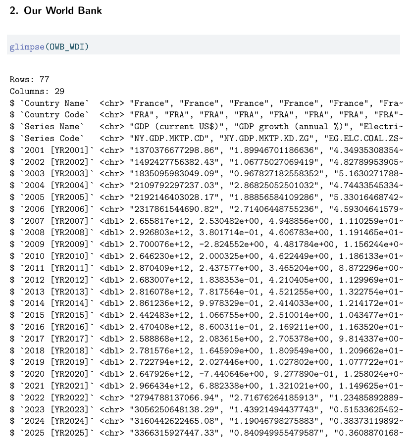

# Project 02 Proposal: Oil to Algorithms
### Studying how the effects of energy production and technology growth have affected GDP
---
**Team members:** Tristen Hale, Jasper Eerkens

## 1. Problem Statement

**Who, What, Why**
We are trying to investigate how energy sources influence the economic growth of countries, particularly as the technology and artificial intelligence (AI) industries continue to expand. 

Countries balance energy production and consumption to support economic growth, while trying to meet the increasing energy demands of technology-driven industries. This is particularly true with the increase of data centers to support AI growth. 

By better understanding the relationship between a country’s GDP, energy, and the growth of the technology industry, we can help countries make more informed decisions about their energy policies and long-term economic strategies. 

**Outcome**
We expect to find supporting evidence towards this relationship, given the varying levels of GDP, technological advancements, and available energy types across the world.

## 2. Research Question

How has the energy (ie. oil, gas, wind/solar) impacted the GDP of the United States, France, Germany, and Poland, considering the growth of technology/AI industry.

## 3. Data Acquisition

All the data we plan to use for our project will be **downloaded** directly from the source. 

### a. Confirm Viability

**Dataset Citations**
1. IEA. (2026). *World Energy Balances* \[Dataset\]. Retrieved November 14, 2026, from https://www.iea.org/data-and-statistics/data-product/world-energy-balances
2. World Bank Group. (2026). *World Development Indicators* \[Dataset\]. Retrieved November 18, 2026, from https://databank.worldbank.org/source/world-development-indicators
3. OECD. (2026). *STAN Database for Structural Analysis, 2025 edition* \[Dataset\]. Retrieved November 17, 2026, from https://data-explorer.oecd.org/vis?tm=stan&pg=0&snb=2&df[ds]=dsDisseminateFinalDMZ&df[id]=DSD_STAN%40DF_STAN_2025&df[ag]=OECD.STI.PIE&df[vs]=1.0&dq=A.FRA._T...&pd=2015,&to[TIME_PERIOD]=false
4. Sajadieh, S., Fattorini, L., Perrault, R., Gil, Y., Parli, V., Santarlasci, L., Pava, J., Maslej, N., Altman, R., Brynjolfsson, E., Brodley, C., Clark, J., Dignum, V., Kumar, V., Landay, J., Lyons, T., Manyika, J., Niebles, J. C., Shoham, Y., . . . Weld, D. (2026). The AI Index 2026 annual report \[Dataset\]. AI Index Steering Committee, Institute for Human-Centered AI, Stanford University. https://doi.org/10.48550/arXiv.2606.15708

**Dataset Collection Methods**
1. The IEA collects its data using an annual questionare with *cooperating* countries and regions.
2. Our World Bank collects the data for *World Development Indicators* by collecting, consolidating, standardizing/checking, and publishing statistics obtained from countries and international organizations.
3. The OECD collects its data using official statistics and reports from *cooperating* countries, regions, and industrial entities.
4. The researchers collected data for their report from existing databases, academic publications, publically available industry/individual data, government and poilicy records, surveys, etc. *There full methodology for collecting and calculating data is listed in their Appendix.*

### b. Variables of Interest

Each variable is listed using \[1\] - \[4\] to represent the numbered dataset above (ie. The *World Development Indicators* dataset from Our World Bank is \[2\]).

**Categorical**
- \[1\] Country
- \[1\] Product (ie. Oil products, Nuclear)
- \[1\] Flow (ie. Production, Industry)
- \[2\] Country Name
- \[2\] Country Code (ie. 'FRA' is France)
- \[2\] Series Name (ie. GDP growth (annual %))
- \[3\] Referance Area (ie. France)
- \[3\] Economic Activity (ie. Software publishing)
- \[3\] Measure (ie. Gross fixed capital formation, ICT equipment, software and databases)
- \[4\] Country

**Quantitative**
- \[1\] 2001-2025
- \[2\] 2001-2025
- \[3\] TIME_PERIOD (ie. 2001)
- \[3\] OBS_VALUE ('observed value')
- \[4\] Year
- \[4\] Total investment (in billions of US dollars)
- \[4\] Number of companies
- \[4\] H1/H2 2025 AI Diffusion

## 4. Data Example

This is a screenshot of the dataset from Our World Bank.

## 5. EDA

**Wrangling Techniques**
- read/import datasets (ie. read_csv(), read_sheet())
- pivot/bind/join (ie. pivot_longer(), left_join())
- filter 
- mutate (ie. drop_na())

**Visualizing Techniques**
- plot/correlation (ie. ggplot(), geom_point(), cor())

## 6. Modeling

**Models**
- linear regression

**Variables**
- response: GDP of countries
- explanatory: energy type production (ie. oil, gas)
- explanatory: industry sector growth (ie. technology/AI)

## 7. Communicate

The results will be presented *physically* using a **poster**, **trifold**, etc.

## 8. LLM disclaimer

*If* an LLM is used, the following models will be used for the following use cases:

**LLM Models**
- ChatGPT
- Gemini

**LLM Use**
- Debugging
- "Googling"

